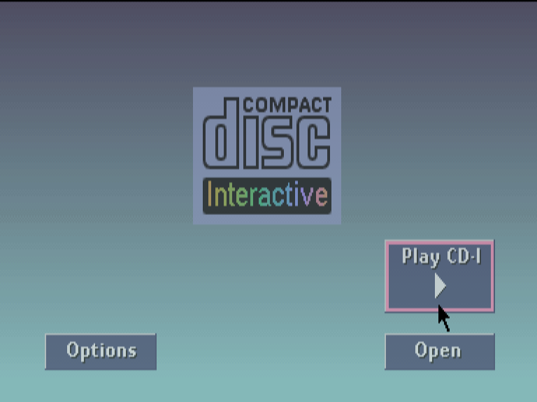
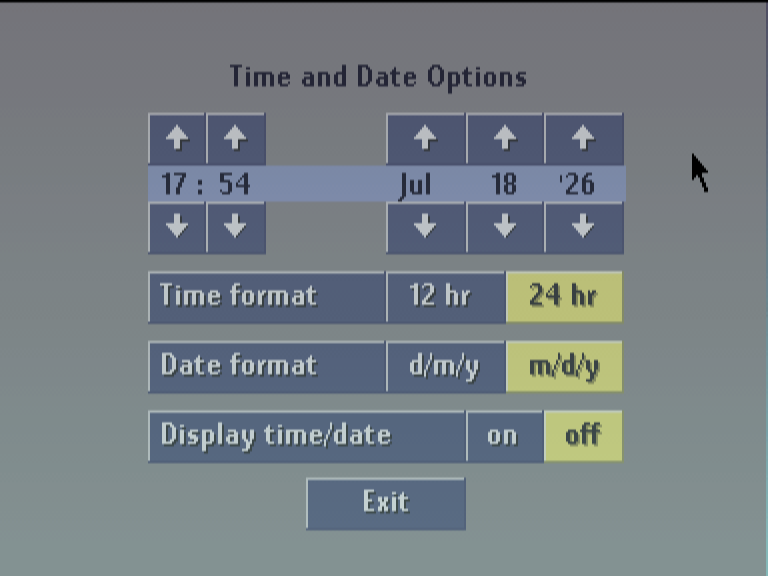

# cdirecomp

A Philips CD-i static recompiler and native runtime. It translates SCC68070 / 68000-family machine code into portable C and executes the real recompiled CD-RTOS / OS-9 system ROM with CD-i hardware models.

This is development software. Hotel Mario is the first standalone game consumer; complete campaigns and correct game-save restoration remain unverified.

<p align="center">
  
  
</p>

## Engine and game projects

This repository owns the CD-i compiler, machine runtime, generated-code ABI, component tests and reusable developer tools. The shared instruction frontend is pinned in `external/m68k-recomp-core`.

[HotelMarioRecomp](https://github.com/mstan/HotelMarioRecomp) owns its game manifest, observed module-entry catalog, launcher, generated BIOS/modules, builds and releases. Game projects pin this engine as a root submodule. No game, BIOS, disc image or generated guest code is distributed here.

## Build and test the engine

Requirements: Git, CMake 3.20+, Ninja, a C11 compiler, Python 3.11+, and SDL2 development files.

```sh
git submodule update --init --recursive
cmake -S . -B build -G Ninja -DCMAKE_BUILD_TYPE=Release
cmake --build build --parallel 2
ctest --test-dir build --output-on-failure
```

The default build needs no BIOS or disc. It builds both recompilers and synthetic/component tests. Building a player requires explicitly supplied generated BIOS sources.

## Documentation

- [Build and generation](docs/BUILDING.md)
- [Game project integration](docs/GAME_PROJECT_SETUP.md)
- [Architecture](docs/ARCHITECTURE.md)
- [Validation boundaries](docs/VALIDATION.md)
- [Debugging](DEBUG.md) and [TCP interface](TCP.md)
- [Runtime instructions](RUNTIME-README.md)
- [Source provenance](PROVENANCE.md) and [third-party notices](THIRD-PARTY-NOTICES.md)

Engineering work is tracked in the central Beads database. Keep session logs, private communications and transient investigation records outside the source repository.

## License

[PolyForm Noncommercial 1.0.0](LICENSE), copyright 2026 Matthew Stan. This license grants no rights to Philips, Nintendo or other third-party software. Supply your own system ROM and disc images.

---

<p align="center">
  <sub><b>R.A.I.D. — Retro AI Development</b> · a Discord for AI-assisted retro reverse-engineering, decomp &amp; recomp</sub>
</p>

<p align="center">
  <a href="https://discord.gg/Ad9BwSzctP"></a>
</p>
